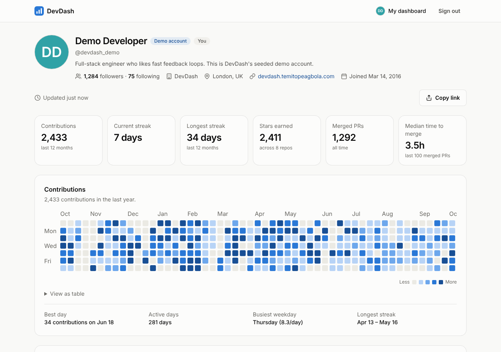
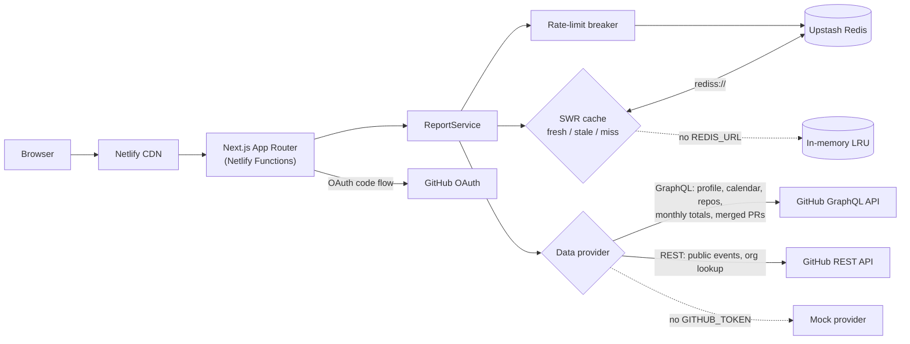

# DevDash

**GitHub developer analytics for any username.** Live: **https://devdash.temitopeagbola.com**

DevDash turns a GitHub username into a shareable dashboard: a year-long contribution
heatmap with streaks, the languages someone actually writes, monthly commits / PRs /
reviews / issues, their top repositories and how quickly their pull requests get merged.
It's a Next.js App Router app that talks to GitHub's GraphQL and REST APIs from the
server, caches every report with stale-while-revalidate semantics in Redis, and degrades
gracefully when GitHub's rate limit runs out. With no API keys it runs entirely on a
deterministic mock provider, so you can clone it and see everything working in a minute.



## Features

- **Search any GitHub user** at `/u/<login>`, or paste a github.com URL. Every profile URL is shareable and has its own Open Graph card.
- **Contribution heatmap** for the last year, with current and longest streaks, best day, active days and busiest weekday.
- **Activity over time**: monthly commits, pull requests, code reviews and issues for 12 months.
- **Language breakdown** by bytes of code across the user's own public repos (forks excluded).
- **Pull request merge time**: median, p90, merge rate, a distribution histogram and median PR size.
- **Top repositories** and a **recent activity** feed from the REST events API.
- **Sign in with GitHub** (OAuth). Signed-in requests use your own API quota first. **Try the demo** signs you into a seeded account in one click.
- **Server-side caching with revalidation**: reports are fresh for 10 minutes, then served stale while a background refresh runs. A manual Refresh button is throttled.
- **Graceful rate-limit handling**: primary and secondary limits are detected on both APIs. A circuit breaker stops calling GitHub until the reset, cached data is served with a banner, and when nothing is cached you get a countdown page.
- **Per-visitor lookup limit**: each visitor can trigger 20 uncached lookups per 10 minutes, so nobody can spend the shared token's quota by scripting random usernames. Cached profiles, the demo and sample-data mode never count.
- Loading skeletons with a slow-request hint, plus empty, not-found, organization and error states. Works down to 375px wide, supports dark mode and the keyboard, and every chart has a "View as table" twin.

## Architecture



How a profile request flows:

1. `/u/[login]` (a server component) validates the login with zod and reads the encrypted session cookie.
2. `ReportService` asks the SWR cache for `report:v1:<provider>:<login>`. On a hit the request never touches GitHub.
3. On a miss, the provider fetches everything in parallel: two GraphQL queries and one REST call. It tries the viewer's OAuth token first, then the server token, and skips any token whose breaker is open.
4. `buildReport()` turns the raw data into the dashboard model. It's pure and unit-tested, and the cache stores its output, not raw payloads.
5. Charts render on the client with Recharts. The heatmap is a custom SVG.

The code is split the same way: `src/lib/github` (HTTP client, queries, zod schemas, real and mock providers), `src/lib/analytics` (pure functions), `src/lib/cache` (stores, SWR, breaker), `src/lib/auth` (OAuth, sessions), `src/app` (routes) and `src/components` (UI).

## Run it locally

Requires Node 22+.

```bash
cd apps/web
npm install
cp ../.env.example .env.local   # optional; everything works with it empty
npm run dev                     # http://localhost:3000
```

With no `GITHUB_TOKEN` the app runs in **sample-data mode**: any username returns deterministic generated data, labelled "Sample data". These logins show the edge states: `mock-empty`, `mock-not-found`, `mock-org` and `mock-rate-limited`. Add a `GITHUB_TOKEN` for live data. Set `OAUTH_PROVIDER=mock` to try the sign-in flow without an OAuth app.

### Whole system with Docker

```bash
cp .env.example .env            # optional
docker compose up --build       # web on :3000 + Redis
```

Compose runs the production build (Next.js standalone output) with a Redis container as the shared cache, so reports survive web restarts.

### Tests and checks

```bash
cd apps/web
npm run lint        # ESLint + Prettier
npm run typecheck   # tsc --noEmit (strict, noUncheckedIndexedAccess)
npm test            # Vitest: analytics, HTTP client, providers, cache, auth, components
npm run test:e2e    # Playwright smoke suite (builds and starts the app, fully offline)
```

GitHub Actions runs all of these, plus `docker compose build`, on every push and pull request.

## Environment variables

All of them are documented in [`.env.example`](.env.example).

| Variable | Required | Purpose |
| --- | --- | --- |
| `GITHUB_TOKEN` | For live data | Server-side token for the GitHub APIs. A classic personal access token with **no scopes** is enough (public data only). |
| `DATA_PROVIDER` | No | `github` or `mock`. Defaults to `github` when `GITHUB_TOKEN` is set. |
| `SESSION_SECRET` | In production | 32+ chars. Encrypts the session cookie. Without it, sign-in and the demo login are disabled. |
| `GITHUB_OAUTH_CLIENT_ID` / `GITHUB_OAUTH_CLIENT_SECRET` | For "Sign in with GitHub" | GitHub OAuth App credentials. The button is hidden when unset. |
| `OAUTH_PROVIDER` | No | `mock` runs the OAuth flow against a local fake (dev and e2e). |
| `REDIS_URL` | Recommended in production | `redis://` or `rediss://` URL (Upstash). Falls back to per-instance memory. |
| `CACHE_TTL_SECONDS` | No | Fresh window, default 600. |
| `CACHE_STALE_SECONDS` | No | Stale-while-revalidate window, default 86400. |
| `LOOKUP_LIMIT` | No | Uncached lookups per visitor per window, default 20. `0` disables the limit. |
| `LOOKUP_WINDOW_SECONDS` | No | Length of the lookup-limit window, default 600. |
| `SITE_URL` | Recommended in production | Public base URL, used for the OAuth callback and OG images. Falls back to Netlify's `URL`. |
| `MOCK_LATENCY_MS` | No | Mock mode only: adds a delay so you can see the loading states. |

## Deploy

DevDash is a single Next.js app. The existing Netlify site builds it from `apps/web` (see [`netlify.toml`](netlify.toml)) on every merge to `main`.

1. **GitHub token**: create a classic personal access token at github.com/settings/tokens with **no scopes ticked**. It can only read public data, which is all DevDash needs, and it gets 5,000 REST requests and 5,000 GraphQL points per hour.
2. **GitHub OAuth App** (optional): create one at github.com/settings/developers.
   - Homepage URL: `https://devdash.temitopeagbola.com`
   - Callback URL: `https://devdash.temitopeagbola.com/api/auth/github/callback`
3. **Upstash Redis**: create a free database at console.upstash.com and copy the `rediss://` connection string (the TCP URL, not the REST URL).
4. **Netlify** (site settings → Environment variables): set `GITHUB_TOKEN`, `SESSION_SECRET` (`openssl rand -base64 48`), `REDIS_URL`, `SITE_URL=https://devdash.temitopeagbola.com`, and optionally `GITHUB_OAUTH_CLIENT_ID` / `GITHUB_OAUTH_CLIENT_SECRET`. Then trigger a deploy.
5. Check `https://devdash.temitopeagbola.com/api/health`. It reports the active provider, cache backend and which sign-in methods are enabled, never secrets.

OAuth only works on the domain registered as the callback. Deploy previews still serve data and the demo.

### Hosting choices: Render, Neon and Atlas aren't used

The project template lists Render (backend), Neon (Postgres) and Atlas (Mongo). DevDash doesn't need any of them:

- **No separate backend (no Render, no `render.yaml`).** The PROJECT stack is Next.js App Router, which is already full-stack. Server components and route handlers keep the GitHub token on the server and run as Netlify Functions. A separate API on Render's free tier would add a 30–50 s cold start for nothing. The UI still shows a "waking the server…" hint if a first request is slow.
- **No Postgres or Mongo.** There's no relational or document data to keep. Sessions are stateless encrypted cookies, and reports are cache entries with a TTL, which is what Redis is for.

## Stack substitutions

**None.** The app uses the stack exactly as specified: Next.js (App Router), the GitHub REST and GraphQL APIs, Tailwind and Recharts, with a server-side token from env and a mock provider when it's absent.

There is one addition: **Redis (Upstash)** as an optional cache backend, so cached reports and rate-limit state are shared across serverless instances and survive redeploys. It's optional; without `REDIS_URL` an in-memory LRU is used.

## Security notes

- The GitHub token and OAuth secrets are only read on the server. Nothing GitHub-related ships to the browser.
- The OAuth flow requests **no scopes**, so viewer tokens can only read public data. That makes reports safe to cache globally.
- Sessions are encrypted (JWE, `dir` + A256GCM, key derived from `SESSION_SECRET` via HKDF) because they carry the viewer's token. Cookies are `httpOnly`, `SameSite=Lax` and `Secure` in production.
- The OAuth `state` is random, stored in a short-lived cookie and compared in constant time. `returnTo` only accepts same-site paths, so it can't be used as an open redirect.
- Server actions (demo login, sign-out, refresh) get Next's built-in origin check. Refresh is throttled per profile so it can't be used to burn the rate limit.
- Each visitor (IP, or GitHub account when signed in) gets a fixed window of uncached lookups, counted in Redis with an atomic increment. IPs are hashed before they're stored. Over the limit, the page shows a countdown and the API returns 429 with `Retry-After`.
- All input (route params, query strings, env and GitHub responses) is validated with zod. Tokens are hashed before they're used in cache keys.
- Security headers: `X-Content-Type-Options`, `X-Frame-Options: DENY`, `Referrer-Policy` and `Permissions-Policy`.

## Known limitations

- The language breakdown and star count cover the 100 most-starred public, non-fork repos. That's GitHub's page size, and it's enough for nearly everyone.
- Merge-time stats use the 100 most recently created merged PRs.
- The public events feed only goes back 90 days, and GitHub has trimmed some payloads (for example, push commit counts), so summaries degrade to "Pushed to main".
- Without Redis, each serverless instance has its own cache, and lookup counts are per instance too.
- The lookup limit is per visitor, so many different IPs together could still use up the quota. When that happens, the rate-limit breaker and stale cache keep the site usable.
