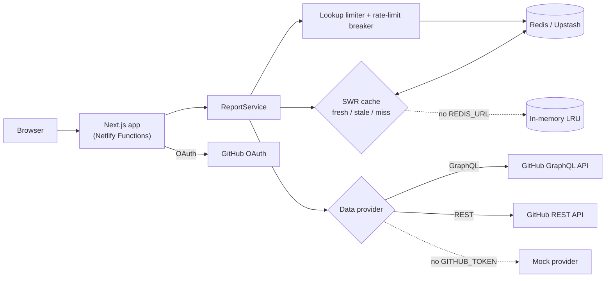

# DevDash

[](https://github.com/temitopeagbola/DevDash/actions/workflows/ci.yml)

**GitHub developer analytics for any username**, for developers who want a quick, shareable picture of how someone ships. Live at **https://devdash.temitopeagbola.com**.


## Overview

GitHub's own profile page shows a contribution graph and pinned repos, but not how someone works over time: which languages they write, how their activity splits between commits, PRs, reviews and issues, or how long their pull requests take to merge. DevDash turns a username into a dashboard that answers those questions.

It's a single Next.js App Router app. Server code calls GitHub's GraphQL and REST APIs, turns the responses into a report and caches it in Redis with stale-while-revalidate. It also keeps working when GitHub's rate limit runs out. With no API keys it runs on a deterministic mock provider, so a fresh clone works straight away.

## Features

- **Search any GitHub user** at `/u/<login>`, or paste a github.com profile URL. Each profile has its own shareable URL and Open Graph image.
- **Contribution heatmap** for the last year, with current and longest streaks, best day, active days and busiest weekday.
- **Activity over time**: commits, pull requests, code reviews and issues per month for the last 12 months.
- **Language breakdown** by bytes of code across the user's own public, non-fork repos.
- **Pull request merge time**: median, p90, merge rate, a distribution histogram and median PR size.
- **Top repositories**, plus a **recent activity** feed from the REST events API.
- **Sign in with GitHub** (OAuth). Signed-in lookups use your own API quota first. **Try the demo** signs you into a seeded sample account.
- **Server-side caching**:
  - Reports are fresh for 10 minutes, then served stale while a background refresh runs.
  - A manual Refresh button is throttled to once a minute per profile.
- **Rate-limit handling**:
  - GitHub's primary and secondary limits are detected on both APIs.
  - A circuit breaker pauses calls until the limit resets.
  - Cached data is served with a banner. If nothing is cached, you get a countdown page.
- **Per-visitor lookup limit**: 20 uncached lookups per visitor per 10 minutes, so nobody can spend the shared token's quota by scripting random usernames. Cached profiles, the demo and sample-data mode don't count.
- **Accessibility and states**:
  - Loading skeletons with a slow-request hint, plus empty, not-found, organization and error states.
  - Works down to 375 px wide, with dark mode and keyboard support.
  - Every chart has a "View as table" version.
- **JSON API** at `/api/profile/<login>` and a health check at `/api/health`.

## Tech stack

| Area | Choice |
| --- | --- |
| Framework | Next.js 16 (App Router, server components, route handlers, server actions), React 19 |
| Language | TypeScript 5.9, strict mode with `noUncheckedIndexedAccess` |
| UI | Tailwind CSS 4, Recharts 3, a custom SVG heatmap |
| Data | GitHub GraphQL API and REST API, validated with zod 4 |
| Auth | GitHub OAuth (no scopes requested), encrypted JWE session cookie via `jose` |
| Cache | Redis via `ioredis` (Upstash in production), with an in-memory LRU fallback. There's no database. |
| Hosting | Netlify (`@netlify/plugin-nextjs`). Docker image and Compose file for running it yourself. |
| Testing | Vitest 5 and Testing Library (unit and component), Playwright (end to end) |
| CI | GitHub Actions |

## Architecture



How a profile request flows:

1. `/u/[login]`, a server component, validates the login with zod and reads the encrypted session cookie.
2. `ReportService` asks the cache for `report:v1:<provider>:<login>`. A cache hit never touches GitHub.
3. On a miss, the visitor's lookup allowance is checked. The provider then makes two GraphQL queries and one REST call in parallel. It tries the viewer's OAuth token first, then the server token, and skips any token whose rate-limit breaker is open.
4. `buildReport()` turns the raw data into the dashboard model. It's a pure, unit-tested function, and the cache stores its output.
5. Charts render on the client with Recharts.

Design notes:

- **No separate backend.** Server components and route handlers keep the GitHub token on the server and run as Netlify Functions.
- **No database.** Sessions are stateless encrypted cookies, and reports are cache entries with a TTL.

### Routes

| Route | What it does |
| --- | --- |
| `/` | Home: search, examples, recently viewed, "Try the demo", "Sign in with GitHub" |
| `/u/[login]` | Profile dashboard |
| `/u/[login]/opengraph-image` | Generated social card for shared links |
| `/search?q=` | Fallback for the search form without JavaScript: validates, then redirects to `/u/<login>` |
| `/api/profile/[login]` | Report as JSON. Sets an `X-Cache` header. Returns 429 with `Retry-After` when rate limited. |
| `/api/health` | Status: data provider, cache backend, whether Redis answers, and which sign-in methods are enabled |
| `/api/auth/github`, `/api/auth/github/callback` | GitHub OAuth start and callback |

## Project structure

```
.
├── apps/web/                 # The Next.js app (the only deployable)
│   ├── src/app/              # Routes, layouts, server actions
│   ├── src/components/       # UI and charts
│   ├── src/lib/github/       # HTTP client, GraphQL queries, zod schemas, real + mock providers
│   ├── src/lib/analytics/    # Pure functions that build the report
│   ├── src/lib/cache/        # Memory/Redis stores, stale-while-revalidate cache, breaker, lookup limiter
│   ├── src/lib/auth/         # OAuth clients, session sealing, cookie helpers
│   ├── e2e/                  # Playwright smoke tests
│   └── Dockerfile            # Multi-stage build (Next.js standalone output)
├── docs/                     # PLAN.md (architecture plan) and the README screenshot
├── .github/workflows/ci.yml  # CI pipeline
├── docker-compose.yml        # App + Redis for local runs
├── netlify.toml              # Netlify build config (base: apps/web)
└── .env.example              # Every environment variable, documented
```

## Getting started

### Prerequisites

- **Node.js 20.9 or newer** (`engines` in `apps/web/package.json`). CI, the Docker image and Netlify all use Node 22.
- **npm** (the repo uses `package-lock.json`).
- **Docker**, optional, to run the app together with Redis.
- **A GitHub token**, optional, for live data. Without one the app uses sample data.

### Install and run

```bash
cd apps/web
npm install
cp ../../.env.example .env.local   # optional; everything works with it empty
npm run dev                     # http://localhost:3000
```

With no `GITHUB_TOKEN`, the app runs in **sample-data mode**: any username returns generated data, labelled "Sample data". These logins show the edge states: `mock-empty`, `mock-not-found`, `mock-org` and `mock-rate-limited`. Set `OAUTH_PROVIDER=mock` to try the sign-in flow without creating an OAuth app.

### With Redis (Docker Compose)

```bash
cp .env.example .env            # optional, from the repo root
docker compose up --build       # app on http://localhost:3000, plus Redis
```

Compose runs the production build with a Redis container as the shared cache. It sets `REDIS_URL` and a local-only `SESSION_SECRET` for you.

### Environment variables

Each one is documented in [`.env.example`](.env.example). All are optional for local development.

| Variable | Purpose |
| --- | --- |
| `GITHUB_TOKEN` | Server-side token for the GitHub APIs. A classic personal access token with no scopes is enough, since DevDash only reads public data. Without it the app uses sample data. |
| `DATA_PROVIDER` | `github` or `mock`. Defaults to `github` when `GITHUB_TOKEN` is set, otherwise `mock`. |
| `MOCK_LATENCY_MS` | Mock mode only: an artificial delay so you can see the loading states. |
| `GITHUB_OAUTH_CLIENT_ID`, `GITHUB_OAUTH_CLIENT_SECRET` | GitHub OAuth App credentials for "Sign in with GitHub". The button is hidden when these are unset. |
| `OAUTH_PROVIDER` | Set to `mock` to run the OAuth flow against a local fake (development and e2e tests). |
| `SESSION_SECRET` | Encrypts the session cookie. Must be 32 or more characters, and is required in production for sign-in and the demo login. |
| `REDIS_URL` | `redis://` or `rediss://` URL for the shared cache. Without it, each instance keeps its own in-memory cache. |
| `CACHE_TTL_SECONDS` | How long a report is served without revalidating. Default 600. |
| `CACHE_STALE_SECONDS` | How long a stale report may still be served while refreshing or rate limited. Default 86400. |
| `LOOKUP_LIMIT`, `LOOKUP_WINDOW_SECONDS` | Uncached lookups allowed per visitor per window. Defaults are 20 per 600 seconds; `0` turns the limit off. |
| `SITE_URL` | Public base URL, used for the OAuth callback and Open Graph images. Falls back to Netlify's `URL`, then `http://localhost:3000`. |

The app checks these values at startup and during `next build`. An invalid value, such as a short `SESSION_SECRET` or a `REDIS_URL` that isn't `redis://` or `rediss://`, fails with an error naming the variable.

## Scripts

Run these from `apps/web`:

| Command | What it does |
| --- | --- |
| `npm run dev` | Development server on port 3000 |
| `npm run build` | Production build |
| `npm run start` | Serve the production build |
| `npm run lint` | ESLint, then a Prettier check |
| `npm run format` | Format with Prettier |
| `npm run typecheck` | `tsc --noEmit` |
| `npm test` | Unit and component tests (Vitest) |
| `npm run test:watch` | Vitest in watch mode |
| `npm run test:e2e` | Playwright end-to-end tests |

There are no migrations or seed scripts. The demo account's data is generated in code (`src/lib/github/demo-fixture.ts`).

## Testing

```bash
cd apps/web
npm test                            # unit + component tests
npx playwright install chromium     # one-time browser download for e2e
npm run test:e2e                    # builds the app, starts it on :3200, runs the smoke tests
```

- **Unit tests** cover the analytics functions, the GitHub HTTP client and error mapping, both data providers, the cache, breaker and lookup limiter, the report service, env validation, sessions and OAuth.
- **Component tests** cover the search form and the heatmap.
- **End-to-end tests** run fully offline, using the mock data provider and mock OAuth. They cover search, demo sign-in and sign-out, the GitHub sign-in flow, OAuth state rejection, the error and empty states, the JSON API and the 375 px layout.

GitHub Actions ([`ci.yml`](.github/workflows/ci.yml)) runs on every push and pull request. One job runs lint, typecheck, unit tests, build and the e2e tests; a second runs `docker compose build`.

## Deployment

Netlify builds `apps/web` with `npm run build` on Node 22 and the Next.js runtime plugin (see [`netlify.toml`](netlify.toml)). Merges to `main` deploy to production, and pull requests get deploy previews.

Production settings, in the Netlify site's environment variables:

- **Required:** `GITHUB_TOKEN`, `SESSION_SECRET`, `SITE_URL`.
- **Recommended:** `REDIS_URL` (Upstash's `rediss://` connection string, not its REST URL).
- **Optional:** `GITHUB_OAUTH_CLIENT_ID` and `GITHUB_OAUTH_CLIENT_SECRET`. The OAuth App's callback URL must be `<SITE_URL>/api/auth/github/callback`.

GitHub sign-in only works on the domain registered as the callback, but deploy previews still serve data and the demo.

After a deploy, check `/api/health`. It reports the data provider, the cache backend, whether Redis answers (`cacheReachable`), and which sign-in methods are enabled. It never shows secret values.

To host it somewhere else, the `apps/web/Dockerfile` builds a standalone image that serves on port 3000.

## Security notes

- **Server-only secrets.** The GitHub token and OAuth secrets are only read on the server.
- **Public data only.** The OAuth flow requests no scopes, so viewer tokens can only read public data. That makes cached reports safe to share between visitors.
- **Encrypted sessions.** The session cookie is a JWE (`dir` + A256GCM, with the key derived from `SESSION_SECRET` via HKDF), because it carries the viewer's token. It's `httpOnly`, `SameSite=Lax`, and `Secure` in production.
- **OAuth hardening.** The OAuth `state` is random, stored in a short-lived cookie and compared in constant time. `returnTo` only accepts same-site paths, so it can't be used as an open redirect.
- **Server actions.** Demo login, sign-out and refresh use Next's built-in origin check, and refresh is throttled per profile.
- **Validation and hashing.** Route params, query strings, env and GitHub responses are all validated with zod. Tokens and visitor IPs are hashed before they're used in cache keys.
- **Security headers:** `X-Content-Type-Options`, `X-Frame-Options: DENY`, `Referrer-Policy` and `Permissions-Policy`.

## Known limitations

- **Repo coverage.** The language breakdown and star count cover the 100 most-starred public, non-fork repos, because that's GitHub's page size.
- **Merge-time sample.** Merge-time stats use the 100 most recently created merged PRs.
- **Activity history.** The public events feed only goes back 90 days, and GitHub has trimmed some event payloads, so some summaries are less detailed (for example "Pushed to main" without a commit count).
- **No Redis.** Without Redis, each server instance has its own cache and its own lookup counts.
- **Distributed abuse.** The lookup limit is per visitor, so many different IPs could still use up the shared token's quota together. If that happens, the breaker and stale cache keep the site usable.

## Contributing

There's no CONTRIBUTING.md. The workflow is:

1. Branch from `main`.
2. Run `npm run lint`, `npm run typecheck`, `npm test` and `npm run test:e2e` in `apps/web`.
3. Open a pull request. CI and a Netlify deploy preview run automatically.
4. Merge once they're green. Merging to `main` deploys to production.

## License

All rights reserved. There's no LICENSE file in this repository.
